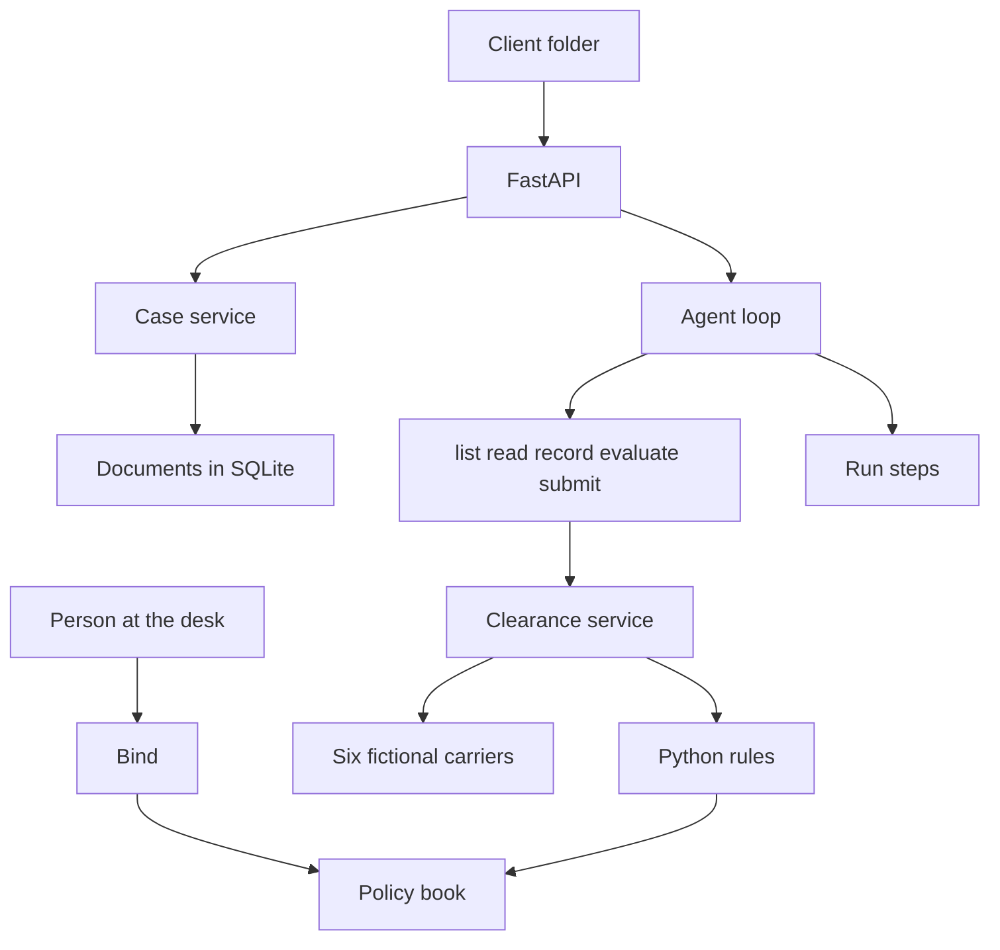

# Clearance

Clearance reads a new-business folder and writes a short memo: quote, refer, decline, incomplete, or out of scope. The premium and the recommendation come from Python rules. The model supplies cited facts and a memo that has to agree with those rules. A person binds the policy.

The people, the documents, and the carrier prices are fictional. Nothing in this repository is a real book of business, a government ID, or a filed rate.

SDIP in this project is points inside the window, not the legal Massachusetts worksheet.



The loop has five tools and a budget of 8 model steps: `list_documents`, `read_document`, `record_facts`, `evaluate`, and `submit_memo`. `build_memo` is the only writer of a memo. The carrier and the premium on that memo come from `shop`. There is no bind tool. `POST /cases/{id}/bind` runs the rules again. The term starts today and ends on the one-year anniversary. The expiration date is not a covered day.

A quote for Marcus Hale on 15 June 2026 is Northglass Auto at 738.00. That number is the rater's, not a filed rate.

## Run

Python 3.12 or newer. From this folder, in PowerShell:

```powershell
python -m venv .venv
.\.venv\Scripts\python.exe -m pip install -r requirements.txt
$env:CLEARANCE_MODEL = "fake"
.\.venv\Scripts\python.exe -m uvicorn app.main:app --host 127.0.0.1 --port 8000
```

Open [http://127.0.0.1:8000/](http://127.0.0.1:8000/). The page is a quote flow: Driver, Vehicle, then Record, then a quote card with the premium, the carrier, and Bind. Sample files for Marcus Hale, Helen Brooks, and the injection note sit under the form. Stop the server with Ctrl+C. The 90-second script is [docs/demo-script.md](docs/demo-script.md).

`CLEARANCE_MODEL=fake` plays a built-in demo script and does not call a model. `CLEARANCE_MODEL=live` calls `grok-4.7` and needs `XAI_API_KEY` in the environment. With neither the variable nor the key, `POST /cases/{id}/run` returns 400 and names `fake` and `live`. The first run creates `data/clearance.db`. Tests set `CLEARANCE_DB` to a temporary file.

## Use the desk

One command starts the server with `CLEARANCE_MODEL=fake`. It is the block above.

Open [http://127.0.0.1:8000/](http://127.0.0.1:8000/). Walk Driver, Vehicle, and Record, then press See your quote. Or press Marcus Hale and read the quote card. The premium is fictional. The desk date is 15 June 2026. Bind is enabled only when the card is a quote.

## Marcus, on the fake model

Set `CLEARANCE_MODEL` to `fake` in the server process. In another PowerShell window:

```powershell
$base = "http://127.0.0.1:8000"
$case = Invoke-RestMethod -Method Post -Uri "$base/cases"
$id = $case.id
$folder = @"
insured_name: Marcus Hale
license_number: S10000023
license_issued_on: 2014-03-01
license_expires_on: 2028-03-01
vin: 1FAKE0HALE0CAR001
plate: MA 4KTP92
vehicle_year: 2018
prior_policy_expires_on: 2027-03-01
sdip_points: 0
line_of_business: auto
"@
$document = @{ name = "folder.txt"; body_text = $folder } | ConvertTo-Json
Invoke-RestMethod -Method Post -Uri "$base/cases/$id/documents" -ContentType "application/json" -Body $document
Invoke-RestMethod -Method Post -Uri "$base/cases/$id/run?today=2026-06-15"
Invoke-RestMethod -Method Post -Uri "$base/cases/$id/bind?today=2026-06-15"
```

The bind response has `effective_on` 2026-06-15 and `expires_on` 2027-06-15.

## Tests

```powershell
.\.venv\Scripts\python.exe -m pytest
```

GitHub Actions runs that command on Ubuntu for every push and pull request. The job installs `requirements.txt` and runs `pytest`. It has no API key and does not call xAI. The suite covers the health route, the case and document API, cited facts, the memo premium, the recommendation order, the Northglass premium of 738.00, the agent loop, bind, and the structural evaluation.

```powershell
.\.venv\Scripts\python.exe -m evals.run_eval
```

structural: 10/10. Given a true fact set, the memo obeys the rules. This score does not measure the model.

live: not measured.

## Notes

The desk flow is in [docs/architecture.md](docs/architecture.md). The rules decide coverage: [docs/decisions/001-rules-decide.md](docs/decisions/001-rules-decide.md). The loop is one function: [docs/decisions/002-one-loop.md](docs/decisions/002-one-loop.md). The database is one SQLite file: [docs/decisions/003-sqlite.md](docs/decisions/003-sqlite.md). The prompt is a file: [docs/decisions/004-prompt-files.md](docs/decisions/004-prompt-files.md). CI uses a fake model: [docs/decisions/005-fake-model-in-ci.md](docs/decisions/005-fake-model-in-ci.md). Operating notes are in [docs/runbook.md](docs/runbook.md).
