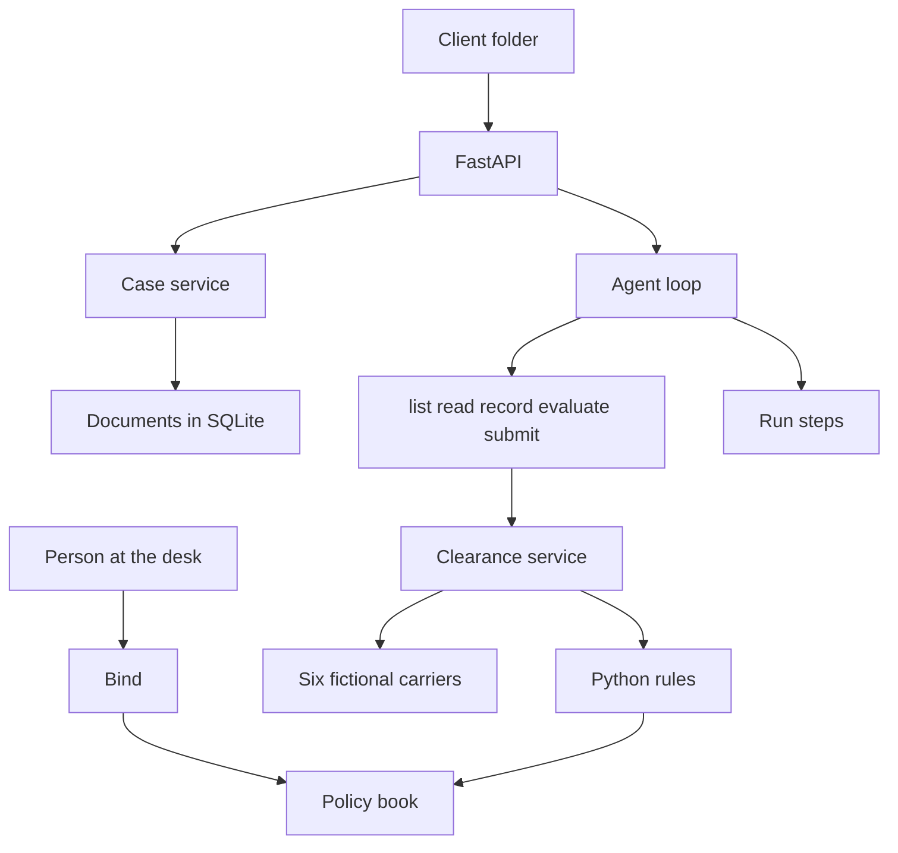

# Architecture

Clearance is the back end for the new-business desk of a personal-lines agency. The broker uploads the client folder. An agent reads the documents, records facts with citations, and proposes a memo. Python rules compute the recommendation and the premium. The tool stores the memo when it agrees with those rules. A person binds the policy. The rules run again at bind time, and only then does the book gain a policy.

Phase 8 code serves the one-column desk at `/`. The page loads Marcus, Helen, and the injection note through the case API. `CLEARANCE_MODEL=fake` runs the demo script. Bind and Close call the real routes. `live` still calls xAI only when that variable is set.

## One case

1. `POST /cases` creates the case.
2. `POST /cases/{id}/documents` stores each text file.
3. `POST /cases/{id}/run` runs the loop.
4. The loop reads the documents, records cited facts, calls `evaluate`, and calls `submit_memo`.
5. `submit_memo` recomputes the rules. A memo that disagrees comes back as an error, and the loop continues, up to 8 steps.
6. `GET /cases/{id}` returns the facts, the conflicts, the memo, and the trace.
7. `POST /cases/{id}/bind` writes a policy when the stored memo is `quote` and the rules still agree.

## The loop

`POST /cases/{id}/run` calls `run_case`. The system message is `app/agent/prompts/clearance-v1.md`. The user message carries the case id. Each model call counts as one step, up to 8.

The tools, in order, are `list_documents`, `read_document`, `record_facts`, `evaluate`, and `submit_memo`. `record_facts` uses the same citation checks as the manual fact post and writes the facts on this run. `evaluate` returns the legal recommendation and the offers. It does not store a memo. `submit_memo` stores a memo only when its recommendation matches that result, and only through `build_memo`. The carrier and premium on the memo come from `shop`.

A tool error is JSON `{"error": "..."}` and the loop continues. A model response with no tool call is told to call `evaluate` or `submit_memo`, and that response uses one step. An accepted memo ends the run as `completed`. At step 8 with no accepted memo, the run ends as `budget_exhausted` and no new memo is stored. Each model response and each tool call is a row in `steps`.

The live client sends `store: false`. The next live turn sends the previous response output back, including reasoning items. The tests inject `FakeLLM` and do not call the network.

## Recommendations

`recommend(facts, today)` is a pure function. The first match wins.

| Order | Recommendation | When |
|---|---|---|
| 1 | `out_of_scope` | At least one line is on file, none of those values is auto, and there is no VIN. A missing line stays on the auto desk. |
| 2 | `decline` | A license is present and `license_expires_on` is on or before today. |
| 3 | `incomplete` | The file is on the auto desk and a required field is missing: `insured_name`, `license_number`, `vin`, or both `license_issued_on` and `prior_policy_expires_on`, so years licensed cannot be estimated. A missing line stays on that desk. |
| 4 | `refer` | The same field is cited in two documents with different values, the prior policy has already expired, `sdip_points` is missing, or `sdip_points` is 4 or more. |
| 5 | `quote` | Everything else. |

A plate conflict with the same VIN can still be rated. The recommendation is `refer`.

`quote` needs at least one firm offer from the rater. The premium on the memo is the number the rater returns.

SDIP here is points inside the window, the same public simplification as Policy Desk. It is not the legal Massachusetts worksheet.
